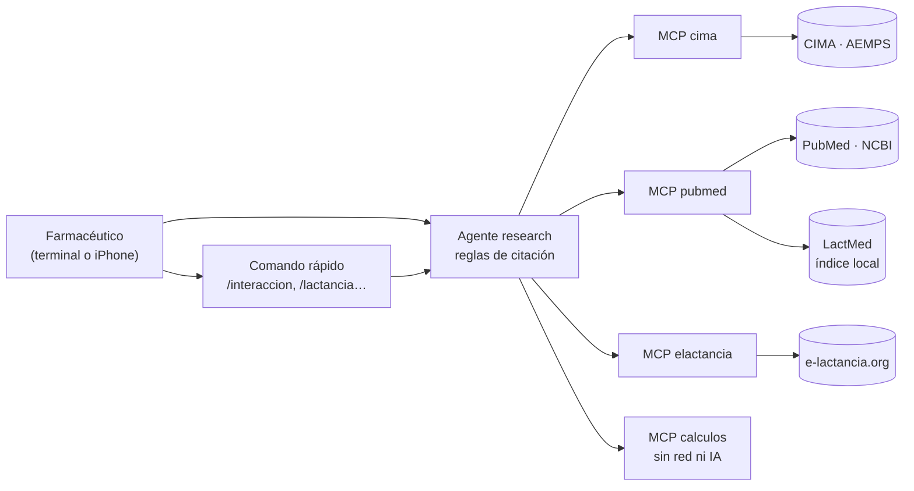

# Farmaclaw

[](https://github.com/rzazo24/farmaclaw/actions/workflows/pruebas.yml)

Agente de research para consejo farmacéutico dentro de [Claude Code](https://claude.com/claude-code). Responde a preguntas de mostrador (interacciones, posología, embarazo, lactancia, problemas de suministro…) con información de **CIMA (AEMPS)**, **PubMed**, **LactMed** y **e-lactancia**, citando cada afirmación con su enlace. Pensado para usarse también desde el móvil con Remote Control.

> [!WARNING]
> **Herramienta de apoyo para profesionales sanitarios. No es un producto sanitario.**
> - No sustituye el juicio clínico ni las bases de datos de referencia (p. ej. Bot PLUS para interacciones).
> - Las respuestas las genera un modelo de IA a partir de fuentes externas: pueden contener errores, omisiones o información desactualizada. Comprueba siempre la fuente enlazada.
> - La decisión clínica es siempre responsabilidad del profesional.
> - No introduzcas datos identificativos de pacientes.

## Cómo funciona



1. Haces una pregunta, directamente o con un comando rápido.
2. El agente **research** decide qué consultar y llama a los **servidores MCP** del proyecto (programas en Python que Claude Code arranca solo).
3. Cada servidor consulta su fuente y devuelve solo el fragmento pedido (p. ej. la sección 4.5 de una ficha técnica), siempre con su URL.
4. El agente redacta la respuesta usando **solo** lo que ha leído, con una cita y enlace en cada afirmación.

## Instalación (Ubuntu)

Requisitos: [Claude Code](https://claude.com/claude-code) instalado y con sesión iniciada, `git` y `curl`.

```bash
git clone https://github.com/rzazo24/farmaclaw.git ~/farmaclaw
cd ~/farmaclaw
curl -LsSf https://astral.sh/uv/install.sh | sh   # gestor de Python (si no lo tienes)
uv sync                                           # instala Python 3.11+ y las dependencias
uv run python mcp/pubmed/lactmed.py               # crea el índice de LactMed (~1 min)
```

Opcional, clave del NCBI para que PubMed permita 10 peticiones/s en vez de 3 ([créala aquí](https://www.ncbi.nlm.nih.gov/account/settings/), en *API Key Management*). Añádela al final de `~/.bashrc`, nunca al repositorio:
```bash
export NCBI_API_KEY=tu_clave
export NCBI_EMAIL=tu@correo
```

Opcional, correo para **Unpaywall** (lo exige en cada consulta; sin él, `texto_completo` no busca copias abiertas en PDF):
```bash
export UNPAYWALL_EMAIL=tu@correo
```

### Primer arranque: aprobar los servidores MCP
```bash
cd ~/farmaclaw && claude
```
Claude Code pregunta si confías en los servidores de `.mcp.json` (`cima`, `pubmed`, `elactancia`): apruébalos. Compruébalo con `/mcp` (deben salir como *connected*) o, fuera de Claude, con `claude mcp list`. Si los rechazaste por error, actívalos desde `/mcp`.

## Uso

Escribe la pregunta en lenguaje natural o usa un comando rápido:

| Comando | Ejemplo | Qué hace |
|---|---|---|
| `/interaccion` | `/interaccion omeprazol clopidogrel` | Lee la sección 4.5 de **todos** los fármacos (admite 3 o más) y analiza cada pareja: mecanismo, relevancia clínica y manejo |
| `/embarazo` | `/embarazo ibuprofeno tercer trimestre` | Ficha técnica 4.6 (y 4.3), notas de seguridad de la AEMPS y metaanálisis de los últimos 10 años |
| `/lactancia` | `/lactancia sertralina` | Cruza e-lactancia (nivel de riesgo), LactMed y la ficha 4.6; muestra las tres posturas si difieren |
| `/dosis` | `/dosis ibuprofeno niños 15 kg` | Ficha 4.2; con peso, calcula la dosis paso a paso (mg/kg × peso) y la máxima; ajustes renal/hepático |
| `/suministro` | `/suministro citicolina` | Problemas activos con fechas y observaciones, y presentaciones alternativas sin problemas |

Ejemplos de preguntas libres:
- "¿Qué dice la ficha técnica del clopidogrel sobre el omeprazol?"
- "¿Hay metaanálisis recientes sobre IBP y clopidogrel?"
- "¿Qué es el CN 712729?" / "¿Qué CN tiene la Aspirina C de 20 comprimidos?"

Cada consulta completa tarda **1-2 minutos**: el agente lee varias fichas y artículos antes de responder.

Desde el iPhone: activa `/remote-control` en la sesión (o usa el [arranque automático](#arranque-automático-siempre-disponible-en-el-móvil)) y abre la sesión en la app de Claude.

## El agente `research`

Definido en `.claude/agents/research.md`. Solo tiene acceso a las herramientas de los servidores MCP del proyecto (ni web ni archivos), y sigue estas reglas:

- **Solo lo que ha leído.** Responde únicamente con información obtenida de las herramientas en esa conversación. Si no la encuentra, dice *"No he encontrado evidencia"* y explica qué buscó. Si una API falla, lo dice en vez de suponer.
- **Una cita por afirmación clínica**, con enlace: `[CIMA: nombre, sección X]`, `[PMID: 12345678]`, `[LactMed: fármaco]`, `[e-lactancia: producto]`. No cita un artículo sin haber leído su resumen.
- **Prioridad de fuentes:** ficha técnica de CIMA (lo autorizado en España) → guías de práctica clínica, metaanálisis y revisiones sistemáticas → ensayos clínicos → casos clínicos (solo como apoyo). Si la evidencia y la ficha difieren, muestra ambas.
- **Dudas de diagnóstico:** no diagnostica. Con fuentes, dice si un síntoma puede ser un efecto adverso (sección 4.8), cuándo derivar al médico (ficha y prospecto) y qué dicen las guías de práctica clínica de PubMed, indicando de quién son, de qué año y de qué ámbito (pueden no coincidir con la práctica en España).
- **Interacciones:** lee la sección 4.5 de ambos fármacos; explica mecanismo, relevancia clínica y manejo práctico; termina siempre con *"No detectar una interacción aquí no garantiza que no exista; contrastar con Bot PLUS"*.
- **Lactancia:** consulta e-lactancia, LactMed y la ficha 4.6, empezando por el nivel de riesgo de e-lactancia.
- **Seguridad:** revisa las notas de seguridad de la AEMPS y los materiales informativos cuando existen (pueden ser más recientes que la ficha).
- **Lee completo:** las secciones largas llegan por partes y no dice que algo "no consta" sin leerlas todas.
- **Formato móvil:** respuesta breve (2-4 frases), después detalle en viñetas y referencias.
- **Privacidad:** nunca pide ni guarda datos identificativos de pacientes.

## Herramientas

### `cima`: CIMA (AEMPS)
| Herramienta | Qué hace | Detalles |
|---|---|---|
| `buscar_medicamento` | Busca medicamentos autorizados en España | Acepta nombre comercial, principio activo, código nacional (CN, también con dígito de control: `712729.8`) o nº de registro. Busca a la vez por nombre y por principio activo (así salen genéricos y marcas). Muestra hasta 15, primero los comercializados que empiezan por lo buscado |
| `ficha_tecnica_seccion` | Una sección de la ficha técnica | Por número (`4.2`, `4.5`…) o alias (`posologia`, `contraindicaciones`, `interacciones`, `embarazo`, `reacciones adversas`…). Texto limpio, sin HTML |
| `prospecto_seccion` | Una sección del prospecto (1-6) | Alias: `qué es`, `antes de tomar`, `cómo tomar`, `efectos adversos`, `conservación`, `composición` |
| `presentaciones` | Envases del medicamento con su CN | Acepta nº de registro o CN. Por envase: CN, nombre (tamaño), comercializado y problemas de suministro |
| `problemas_suministro` | Problemas de suministro por presentación | Acepta nombre, principio activo, nº de registro o CN. Estado, fecha de inicio, fin prevista y observaciones |
| `notas_seguridad` | Notas informativas de seguridad de la AEMPS | Más recientes primero, con enlace a cada nota |
| `materiales_informativos` | Guías de seguridad aprobadas por la AEMPS | Para profesionales y pacientes (guías, tarjetas, formularios) |

Las secciones de más de 8.000 caracteres se devuelven **por partes** (`parte=1, 2…`, con `total_partes`), cortando por párrafos.

### `pubmed`: PubMed y LactMed (NCBI)
| Herramienta | Qué hace | Detalles |
|---|---|---|
| `buscar_articulos` | Búsqueda en PubMed por relevancia | Filtros opcionales: tipo (`Meta-Analysis`, `Systematic Review`, `Randomized Controlled Trial`, `Review`, `Case Reports` y, para **guías de práctica clínica**, `Practice Guideline` y `Guideline`) y año mínimo. Devuelve la consulta exacta usada, para repetirla en la web |
| `obtener_resumen` | Abstract y metadatos (hasta 10 PMIDs) | Autores abreviados, revista, año, abstract por apartados, MeSH, DOI y enlace al texto completo en PMC si existe |
| `texto_completo` | Texto completo de copias legales de acceso abierto | Por PMID, PMCID o DOI. Busca en orden en **PubMed Central**, **Europe PMC** (incluye preprints) y **Unpaywall** (PDF abiertos de la editorial o de repositorios). Primero un índice (origen y versión, secciones, tablas, licencia); luego cada sección (`Methods`, `resultados`, número…), `tablas` o `declaraciones` (financiación y conflictos de interés), por partes. Sin bibliografía. De los PDF no se extraen tablas y las secciones se detectan de forma aproximada. Si no hay copia abierta, dice dónde ha buscado y remite al abstract |
| `lactmed` | LactMed: fármacos y lactancia | Nombre en **inglés** (acepta equivalencias habituales: paracetamol → acetaminophen, salbutamol → albuterol, metamizol → dipyrone…). Secciones: `resumen` (con alternativas y clase), `niveles`, `efectos_lactante`, `efectos_lactancia`, `alternativas`. Las citas aparecen como `[PMID: …]` |

El agente usa `texto_completo` solo cuando el abstract no basta (tablas, métodos, subgrupos, conflictos de interés) y para pocos artículos clave; los datos que salen de ahí se citan con su origen (`[PMC…, sección X]`, `[Europe PMC …]`, `[Texto completo vía Unpaywall …]`) y, si es un preprint o un manuscrito aceptado, lo dice.

LactMed se consulta desde un **índice local** (`data/lactmed.json.gz`, ~1,4 MB, no se sube a git): su web bloquea los accesos automáticos, así que se usa la descarga oficial completa del FTP del NCBI.

### `elactancia`: e-lactancia.org (APILAM)
| Herramienta | Qué hace | Detalles |
|---|---|---|
| `elactancia` | Compatibilidad con la lactancia | Principio activo en **español** (para marcas, buscar antes el principio activo en CIMA). Nivel de riesgo de 0 (compatible) a 3 (incompatible), comentario con referencias, alternativas más seguras si las hay y fecha de actualización |

e-lactancia no tiene API pública: se usa su buscador interno y se lee la ficha, solo cuando se pregunta (1 petición/s, caché 24 h), nunca con descargas masivas.

### `calculos`: calculadora (sin red ni IA)
Aritmética determinista en Python (con `Decimal`, para que 15 × 7,5 dé exactamente 112,5), para que el agente no haga cuentas de cabeza. Solo calcula: los datos de partida tienen que salir de la ficha técnica.

| Herramienta | Qué hace | Detalles |
|---|---|---|
| `dosis_pediatrica` | Dosis por peso | Peso (0,5-150 kg) y la dosis tal como la da la ficha: mg/kg **por toma** (`dosis_mg_kg`) o mg/kg **por día** (`dosis_mg_kg_dia`, que se reparte entre `tomas_al_dia`), y opcionales: concentración (mg/mL), tomas al día y máximos por toma y por día de la ficha. Devuelve mg y mL por toma (exacto y redondeado a 0,1 mL), gotas por toma si se da el tamaño de la gota (redondeadas a gota entera), mg/día, la operación paso a paso (`15 kg × 7,5 mg/kg = 112,5 mg; 112,5 mg ÷ 20 mg/mL = 5,625 mL → 5,6 mL`) y avisos: máximo superado (con la dosis limitada al máximo y cuál se ha aplicado) o peso > 40 kg (puede aplicar la dosis de adulto). Valores no válidos → error claro, nunca un número |
| `convertir` | Conversiones simples | mg ↔ mL (con concentración), mcg ↔ mg, % → mg/mL (1 % = 10 mg/mL) y gotas ↔ mg/mL **solo** con el tamaño de gota de la ficha, en mg por gota (`mg_por_gota`, p. ej. 4) o en gotas por mL (`gotas_por_ml`); nunca supone 20 gotas/mL. Si hace falta, calcula las gotas/mL con la concentración y lo muestra |

El agente cita los datos de la ficha (`[CIMA: …, sección 4.2]`) y el resultado (`[Cálculo Farmaclaw]`) mostrando la operación. Si la ficha da una tabla por tramos de peso o edad, usa el tramo de la ficha sin recalcular, y si falta el peso lo pide.

### Comportamiento común
- Respuestas compactas: nunca documentos enteros, solo lo pedido, y siempre con un campo `fuente` (URL pública).
- Errores claros en español (no encontrado, API caída, timeout). Timeout de 15 s y un reintento.
- Caché en memoria (1 h; 24 h en e-lactancia).

## Limitaciones conocidas
- **Tiempo:** cada consulta completa tarda 1-2 minutos.
- **Ámbito:** CIMA cubre medicamentos autorizados en España; no incluye productos sanitarios ni la mayoría de complementos alimenticios.
- **Búsqueda en CIMA:** con principios activos muy comunes (más de 100 presentaciones) solo se muestran 15; para una marca concreta, búscala por su nombre.
- **Fichas técnicas:** pueden tardar en actualizarse; por eso el agente revisa también las notas de seguridad.
- **LactMed:** el índice local se actualiza una vez al mes (o a mano). Los nombres van en inglés.
- **e-lactancia:** no resuelve bien las marcas comerciales; la fecha de cada ficha indica su última revisión.
- **No hay acceso** a Bot PLUS, Pediamécum, UpToDate ni otras bases de suscripción: para interacciones, el agente recuerda siempre contrastar con Bot PLUS.

## Arranque automático (siempre disponible en el móvil)

Un servicio de systemd de usuario abre al encender la VM una sesión tmux `farmaclaw` con `claude --remote-control Farmaclaw`, que aparece en la app de Claude. Si la sesión ya existe, no hace nada; espera hasta 2 minutos a que haya red.

```bash
# Instalación (una vez; requiere linger: `loginctl enable-linger $USER`)
mkdir -p ~/.config/systemd/user
ln -sf ~/farmaclaw/systemd/farmaclaw.service ~/.config/systemd/user/
systemctl --user daemon-reload && systemctl --user enable --now farmaclaw.service

tmux attach -t farmaclaw                  # entrar a la sesión desde SSH
~/farmaclaw/scripts/arrancar.sh           # recrearla a mano si la cerraste
systemctl --user status farmaclaw         # ver el estado del servicio
```

> - La sesión se abre con `bash -i`, que carga `~/.bashrc`: la clave del NCBI tiene que estar ahí para que la use.
> - Los servicios de `systemd/` asumen que el proyecto está en `~/farmaclaw`. Si lo clonas en otra ruta, ajusta `%h/farmaclaw` en los `.service`.

### Actualización mensual de LactMed
```bash
ln -sf ~/farmaclaw/systemd/farmaclaw-lactmed.{service,timer} ~/.config/systemd/user/
systemctl --user daemon-reload && systemctl --user enable --now farmaclaw-lactmed.timer
systemctl --user list-timers farmaclaw-lactmed.timer    # próxima ejecución
```
Se ejecuta el día 1 de cada mes; si la VM estaba apagada, al arrancar.

## Web privada (PC y móvil)
`web/` es una página para hacer consultas desde cualquier navegador (por ejemplo, el PC compartido de la farmacia) sin abrir la cuenta de Claude: solo se ve Farmaclaw, no el resto de chats. Cada consulta lanza `claude -p` en la VM, así que usa la sesión de Claude Code y gasta de la suscripción como cualquier otra consulta. **Es para uso personal**: abrirla a otras personas exigiría usar la API.

- **Diseño:** tipos de consulta en tarjetas, progreso en directo (fuentes que va leyendo), respuesta con enlaces, tema claro/oscuro y ayuda integrada. En el PC, menú lateral con las consultas recientes de la sesión (solo en memoria; se borran al reiniciar) y atajos `Ctrl K` / `Ctrl Enter`; en el móvil, barra inferior.
- **Modo rápido (opcional):** un interruptor bajo el cuadro de consulta lanza la consulta con Sonnet en lugar de Opus. Medido con la evaluación (7 casos): la mitad de coste y de tiempo, igual de bien citado, pero una vez dejó sin leer la segunda parte de una sección. Para consultas sencillas; las consultas rápidas llevan ⚡ en el título y en Recientes.
- **Acceso:** contraseña (mínimo 14 caracteres, guardada como hash scrypt) + código TOTP de una app de autenticación (2FAS, Google Authenticator…). Tras 5 fallos seguidos **desde una IP**, esa IP se bloquea 15 min (las demás pueden seguir intentándolo, así que un bot no puede dejarte fuera). Si hay muchos fallos en total (más de 50 en 10 min, p. ej. un ataque desde muchas IP), cada intento fallido tarda más en responder (hasta 5 s), pero con la contraseña y el código correctos se entra siempre. La IP real se toma de la cabecera `X-Forwarded-For` que pone Tailscale Funnel, y solo si la conexión viene de 127.0.0.1. Los intentos fallidos se registran con su IP, nunca con la contraseña ni el código. Como mucho se comprueban **2 contraseñas a la vez** (scrypt usa ~32 MB y CPU a propósito): el resto espera turno hasta 10 s, y si el servidor está saturado (más de 20 esperando o espera agotada) responde 503 sin contarlo como fallo, para que muchos intentos simultáneos no saturen la VM. Tras 6 h sin tocar nada (una jornada; aviso 1 min antes, nunca durante una consulta) la página cierra la sesión y borra la pantalla; además, la sesión caduca siempre a las 8 h.
- **Lo que puede hacer Claude desde la web:** solo delegar en el agente `research` y usar los servidores MCP del proyecto (`--tools Agent`, `--strict-mcp-config`, `dontAsk`). Ni terminal ni archivos ni conectores de claude.ai: aunque alguien entrara, no podría tocar la VM.
- **Publicación:** la web escucha solo en `127.0.0.1:8787` y sale a internet con HTTPS mediante [Tailscale Funnel](https://tailscale.com/kb/1223/funnel) (gratis, sin dominio propio ni abrir puertos).

```bash
# 1. Contraseña y código del móvil (en una terminal de la VM, no por el chat de Claude)
uv run python web/configurar.py          # guarda ~/.config/farmaclaw/web.json (permisos 600)

# 2. Servicio que la arranca con la VM
ln -sf ~/farmaclaw/systemd/farmaclaw-web.service ~/.config/systemd/user/
systemctl --user daemon-reload && systemctl --user enable --now farmaclaw-web

# 3. Publicarla (la primera vez Tailscale puede pedir autorizar Funnel para esta máquina)
tailscale funnel --bg --https=8443 http://127.0.0.1:8787
#    → https://<tu-maquina>.<tu-tailnet>.ts.net:8443
tailscale funnel --https=8443 off        # para dejar de publicarla
```

> - Se usa el puerto 8443 para no interferir con otros servicios publicados en el 443 de la misma máquina.
> - La dirección `*.ts.net` aparece en los registros públicos de certificados: habrá bots que la prueben. Por eso el doble factor y el bloqueo por intentos.
> - Para cambiar la contraseña o el código, vuelve a ejecutar `web/configurar.py` y reinicia el servicio.

## Pruebas
```bash
uv run pytest                    # todas: sin red + llamadas reales a las APIs (~10 s)
uv run pytest -m "not red"       # solo las que no usan red (instantáneas)
claude mcp list                  # los cuatro servidores deben salir "✔ Connected"
```
- **Sin red:** comprueban el procesado de datos (HTML de CIMA, XML de PubMed y LactMed, fichas de e-lactancia, fechas, división por partes) con ejemplos fijos.
- **Con red** (`@pytest.mark.red`): casos reales contra las APIs (p. ej. que la ficha del clopidogrel mencione el omeprazol en la 4.5). Las de LactMed con datos reales se saltan si no existe el índice local.

En GitHub Actions (`.github/workflows/pruebas.yml`) las pruebas sin red se ejecutan en cada push y PR; las de red, en cada push a `main`, **cada lunes** (para detectar cambios en las APIs) y a mano desde la pestaña *Actions*. Si algo falla, GitHub avisa por correo.

## Evaluación del agente
Además de las pruebas, `evaluacion/` lanza 21 preguntas reales (interacciones, lactancia, embarazo, posología, suministro, trampas sin evidencia y privacidad), comprueba automáticamente herramientas consultadas, citas (incluidas citas inventadas) y avisos, y genera un informe para revisión manual por un farmacéutico. Ver [evaluacion/README.md](evaluacion/README.md).

## Estructura
```
.mcp.json                        servidores MCP del proyecto
CLAUDE.md                        contexto e instrucciones para Claude Code
.claude/agents/research.md       agente farmacéutico investigador
.claude/commands/                comandos rápidos (/interaccion, /dosis, /lactancia…)
mcp/cima/server.py               MCP de CIMA (AEMPS)
mcp/pubmed/server.py             MCP de PubMed (+ herramienta LactMed)
mcp/pubmed/lactmed.py            descarga y búsqueda del índice local de LactMed
mcp/elactancia/server.py         MCP de e-lactancia
mcp/calculos/server.py           MCP de cálculos (dosis pediátricas, conversiones)
tests/                           pruebas pytest (sin red y con APIs reales)
evaluacion/                      evaluación del agente: casos reales, informe y revisión manual
web/                             web privada de consultas (FastAPI + contraseña y TOTP)
scripts/arrancar.sh              sesión tmux con Claude Code + Remote Control
systemd/                         servicios de arranque (Claude, web) y temporizador mensual de LactMed
.github/workflows/pruebas.yml    integración continua (GitHub Actions)
data/                            índices descargados (no se sube a git)
```

Para añadir o cambiar una herramienta, `CLAUDE.md` recoge las reglas de los servidores y las particularidades comprobadas de cada API.

## Licencia
El código de Farmaclaw se distribuye bajo licencia [MIT](LICENSE). La licencia cubre solo el código: los datos que consultan los servidores siguen las condiciones de cada fuente.

### Licencias de las fuentes
- **e-lactancia.org** (APILAM): CC BY-NC-SA 4.0. Uso no comercial y con atribución. El servidor consulta solo bajo demanda (1 petición/s, caché 24 h), sin descargas masivas.
- **LactMed** (NIH/NICHD) y **PubMed**: dominio público / uso libre de E-utilities según las normas del NCBI.
- **CIMA** (AEMPS): API pública oficial.
